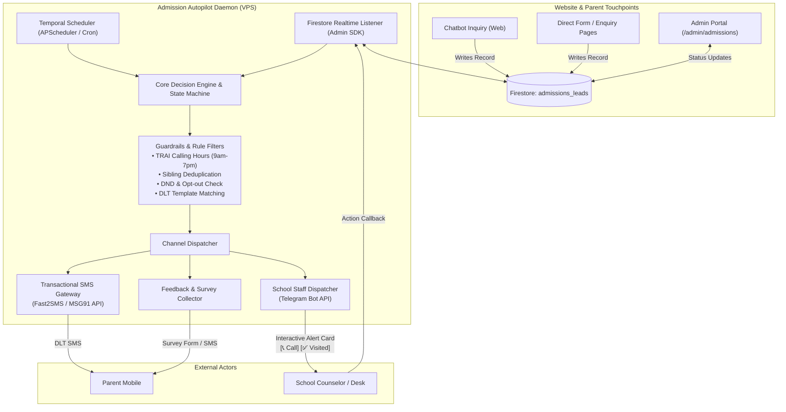

# Technical Architecture Specification: Sarvada Admission Agent

## 1. Architectural Philosophy

The **Sarvada Admission Autopilot Agent** operates as an **autonomous background daemon** separate from the Next.js frontend web application. It monitors the database, evaluates timing rules and business logic, triggers staff reminders, communicates with parents via approved transactional channels, and listens for status transitions (e.g. from `NEW` to `VERIFIED` or `ENROLLED`).



---

## 2. Integration with Existing Website & Data Layer

The agent integrates with the existing website architecture with **zero code changes** needed on the Next.js website:

### A. Data Ingestion via Firestore
The website currently saves all inquiries into the Firestore collection:
* **Collection:** `admissions_leads`
* **Existing Document Schema:**
  ```typescript
  interface ExistingLead {
    referenceNumber: string;     // e.g. "SMS-ADM-2026-6814"
    studentName: string;         // e.g. "Aarav Sharma"
    parentName: string;          // e.g. "Rajesh Sharma"
    phone: string;               // e.g. "9876543210"
    grade: string;               // e.g. "Class 3rd"
    dob?: string;
    status: "NEW" | "CONTACTED" | "VERIFIED" | "ENROLLED" | "REJECTED";
    source: string;              // "AI_Counselor_Journey" | "Online_Form"
    createdAt: Timestamp;
    createdDate: string;
    notes?: string;
  }
  ```

### B. Extended Agent Metadata Schema (Zero Breaking Changes)
The agent automatically enriches each lead with sub-fields without affecting the existing website views:
```typescript
interface EnrichedLeadMetadata {
  // Staff Assignment
  assignedCounselorId?: string;      // e.g. "counselor_priya"
  assignedCounselorName?: string;    // e.g. "Priya Verma"
  
  // Follow-up Tracking
  followUpCount: number;             // 0, 1, 2, 3...
  lastFollowUpAt?: string;           // ISO timestamp
  nextScheduledFollowUpAt?: string;  // ISO timestamp
  followUpHistory: Array<{
    timestamp: string;
    channel: "SMS" | "STAFF_CALL" | "SYSTEM_NOTE";
    templateId?: string;
    status: "SENT" | "DELIVERED" | "FAILED" | "COMPLETED";
    notes?: string;
  }>;

  // Onboarding & Feedback
  enrollmentDate?: string;
  feedbackRequestedAt?: string;
  feedbackScore?: number;            // 1 to 5
  feedbackComments?: string;
  isDND: boolean;                    // Do-not-disturb flag
}
```

---

## 3. Core System Components

### Component 1: Event Listener (Real-Time Intake)
* Uses Firebase Admin SDK (`firebase-admin/firestore`) on the VPS.
* Subscribes to collection `admissions_leads` with `onSnapshot()`.
* **Triggers:**
  * `added`: When a parent submits a new form or chat session on the website.
  * `modified`: When status changes in the admin dashboard (e.g., from `NEW` to `VERIFIED` or `ENROLLED`).

### Component 2: Scheduled Chrono-Worker (Time-Based Rules)
* Runs on a 15-minute evaluation loop.
* Scans for leads requiring follow-up based on elapsed time:
  * Leads in `NEW` status for > 24 hours without counselor contact.
  * Leads in `CONTACTED` status for > 72 hours without school visit.
  * Leads in `ENROLLED` status for 7 days without feedback.

### Component 3: Staff Alert Engine (Telegram Bot vs. Push Notifications)
Why **Telegram Bot** is selected for School Staff Alerts:
1. **Zero Recurring Cost:** Free official Bot API with unlimited messages.
2. **Interactive Inline Action Buttons:** Allows admission counselors to tap `[📞 Call Parent]`, `[Mark Contacted]`, `[Scheduled Visit]`, or `[Enrolled]` directly from their phone without logging into a PC.
3. **Group Dispatch:** Alerts can be sent to a dedicated "Sarvada Admissions Desk" private Telegram group where all desk staff can view and claim leads.

### Component 4: Parent SMS Dispatcher (DLT-Compliant)
Because Sarvada School is **not active on WhatsApp**, transactional SMS is the legal and direct standard in India.
* **Supported Gateways:** Fast2SMS / MSG91 / Textlocal (all support Indian DLT Principal Entity ID registration).
* **Delivery Status Webhook:** Tracks whether the SMS was delivered to the parent handset.

### Component 5: Post-Admission Feedback & Survey Engine
* When the school marks an applicant as `ENROLLED`, the agent schedules an onboarding sequence:
  * **Day 0:** Welcome SMS with campus reporting schedule, uniform counter timings, and book distribution dates.
  * **Day 7:** Feedback collection link (or 2-way SMS reply):
    > *"Namaste! How was your admission experience at Sarvada Modern Secondary School? Rate us 1-5 (5 is Excellent)."*
  * **Alert Trigger:** If rating is $\le 2$, an immediate high-priority alert is sent to the Principal/Management Telegram.

---

## 4. Technology Stack Recommendation

| Component | Selected Technology | Alternative | Rationale |
| :--- | :--- | :--- | :--- |
| **Agent Runtime** | **Python 3.11+ (FastAPI + APScheduler)** | Node.js (TypeScript) | Native Google ADK support, robust data manipulation, lightweight background jobs. |
| **Database Connector**| `firebase-admin` (Service Account) | REST API | Instant socket `onSnapshot` updates, full admin privileges. |
| **Scheduler** | `APScheduler` | Celery + Redis | In-process cron scheduling without requiring external Redis infrastructure for small-to-medium school scale. |
| **Staff Notifications** | `python-telegram-bot` | Twilio SMS / Email | Interactive action buttons, instant notifications, completely free. |
| **Parent SMS Gateway** | `Fast2SMS` / `MSG91` REST API | Twilio | Pre-configured for Indian DLT routes and Telecom regulatory compliance. |
| **Containerization** | `Docker` + `docker-compose` | Bare-metal PM2 | 1-command startup, clean isolation, easy relocation to any VPS. |
| **Hosting Target** | **$4-$6/mo VPS (Ubuntu 22.04 LTS)** | AWS EC2 / DigitalOcean | Cost-effective, 100% uptime, fixed predictable pricing. |

---

## 5. Security & Isolation Model

1. **Read-Only / Scoped Firebase Credentials:**
   * Uses a dedicated Firebase Service Account JSON key stored in the VPS `.env` file.
   * Locked to the `admissions_leads` and `settings/admissions` collections.
2. **Rate Limiting & Anti-Spam:**
   * Hard limit: Maximum **1 SMS per parent per 48 hours** (except for the instant initial receipt).
   * Strict time filter: No parent outbound communication between **7:00 PM and 9:00 AM IST** (TRAI regulation compliance).
3. **No Direct Student Identity Exposure:**
   * Logs and trace outputs mask phone numbers (e.g. `98765****0`).
