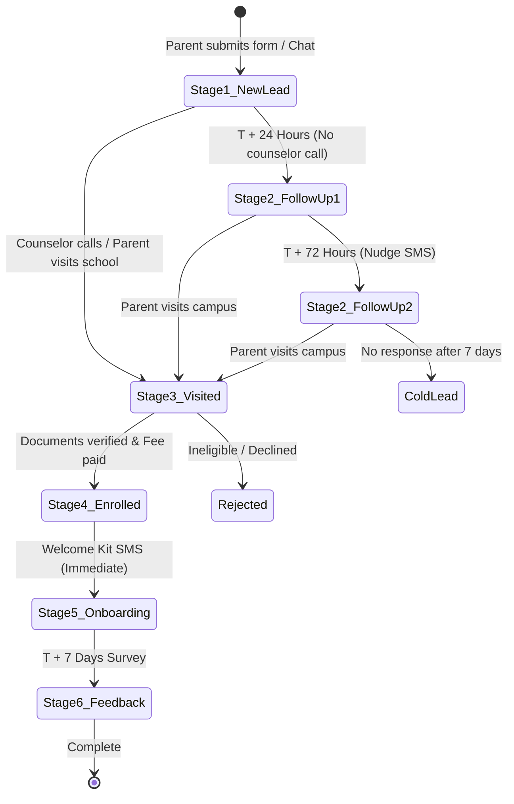
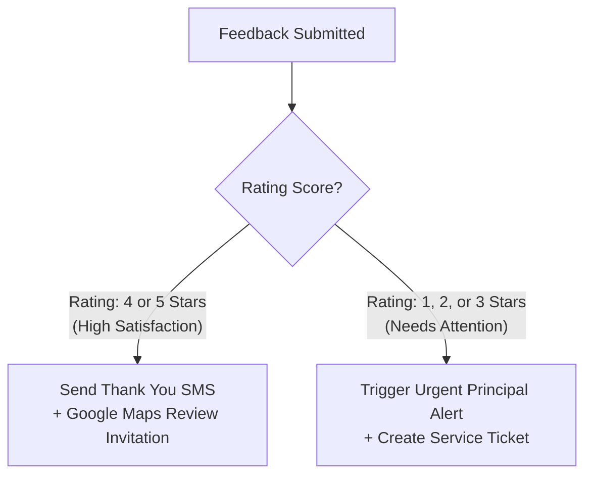

# Admission Follow-Up Playbooks & Message Templates

This document details the exact execution paths, timing rules, and message copy for each stage of the student admission lifecycle at Sarvada Modern Secondary School.

---

## 🧭 The 5 Core Automation Journeys



---

## 📋 Playbook 1: Instant Lead Triaging & Staff Dispatch (T = 0)

* **Trigger:** New lead document added to Firestore `admissions_leads` with `status: "NEW"`.
* **Timing:** Within 30 seconds of submission.

### A. Staff Alert Card (Telegram Bot)
Sent to the private School Admission Desk Telegram channel:

```text
🔔 NEW ADMISSION INQUIRY RECEIVED

• Reference ID: SMS-ADM-2026-6814
• Student: Aarav Sharma
• Class: Class 3rd
• Parent: Rajesh Sharma
• Phone: +91 98765 43210
• Date: 21 Oct 2026, 01:15 PM
• Source: AI Counselor Journey

Inline Action Buttons:
[ 📞 Call Parent Now ]  [ 📝 Mark Contacted ]  [ 🚫 Mark Ineligible ]
```

* Clicking `[ 📞 Call Parent Now ]` opens phone dialer on staff mobile: `tel:+919876543210`.
* Clicking `[ 📝 Mark Contacted ]` triggers an API callback updating Firestore status to `CONTACTED` and logging staff username.

### B. Parent Instant Confirmation SMS
* **Channel:** DLT Transactional SMS.
* **DLT Header:** `SRVADA` (or assigned school 6-character header).
* **Message Copy:**
  > *"Namaste Rajesh Sharma. Your admission inquiry for Aarav (Class 3rd) has been logged at Sarvada Modern Secondary School. Ref: SMS-ADM-2026-6814. Our office will call you within 24 hrs. Campus: Sadatpur, Karawal Nagar. Ph: 9999439422"*

---

## 📋 Playbook 2: Counselor Accountability Check (T = 24 Hours)

* **Trigger:** Lead remains in `status: "NEW"` 24 hours after creation.
* **Filter:** Check current time is within 9:00 AM – 6:00 PM IST (Mon–Sat).

### Staff Reminder (Telegram):
```text
⚠️ PENDING FOLLOW-UP ALERT (Overdue > 24 Hours)

The following lead has not been contacted yet:
• Ref: SMS-ADM-2026-6814
• Student: Aarav Sharma (Class 3rd)
• Parent: Rajesh Sharma (+91 98765 43210)
• Time Elapsed: 24h 15m

Please complete the discovery call today and update status.
[ 📞 Call Parent Now ]  [ ✅ Contacted Today ]  [ 📅 Scheduled Visit ]
```

---

## 📋 Playbook 3: Campus Visit Nudge (T = 72 Hours)

* **Trigger:** Status is `CONTACTED`, but no campus visit has occurred within 72 hours.
* **Target:** Parent Mobile.

### Parent SMS (Soft Nudge):
* **DLT Template Category:** Transactional / Informational.
* **Message Copy:**
  > *"Planning your child's admission visit? Sarvada Modern Secondary School campus is open Mon-Sat, 8:00 AM to 2:30 PM for document verification & campus tours. Ref: SMS-ADM-2026-6814. Directions: Sadatpur, Karawal Nagar, Delhi. Helpline: 9999439422"*

---

## 📋 Playbook 4: Enrollment & Onboarding Handshake (Status = "ENROLLED")

* **Trigger:** School office marks applicant as `ENROLLED` in `/admin/admissions` after fee receipt is issued at the counter.
* **Timing:** Within 5 minutes of status update.

### A. Official Welcome SMS to Parent:
* **Message Copy:**
  > *"Congratulations! Admission for Aarav Sharma in Class 3rd is confirmed at Sarvada Modern Secondary School for Session 2026-27. Ref: SMS-ADM-2026-6814. Book & uniform counter schedule will be shared soon. Welcome to the Sarvada family! Ph: 9999439422"*

### B. Staff Telegram Log:
```text
🎉 ENROLLMENT CONFIRMED
• Student: Aarav Sharma
• Class: Class 3rd
• Ref: SMS-ADM-2026-6814
• Handled By: Counter Admin
• Next Step: Scheduled Day 7 Feedback Survey
```

---

## 📋 Playbook 5: Post-Admission Feedback Survey (T = Enrollment + 7 Days)

* **Trigger:** Exactly 7 days after lead status changed to `ENROLLED`.
* **Timing:** Sent at 11:30 AM IST.

### A. Feedback Request SMS:
* **Message Copy:**
  > *"Namaste Rajesh Sharma. How was your admission and counseling experience at Sarvada Modern Secondary School? Please rate us from 1 (Poor) to 5 (Excellent) by clicking: https://sarvada.edu.in/feedback?ref=SMS-ADM-2026-6814. Your review helps us improve!"*

### B. Rating Decision Engine:



#### If Rating is 4 or 5 Stars:
* Send Thank You note:
  > *"Thank you for your rating! We are thrilled to welcome Aarav. If you have 30 seconds, please share your kind words on our Google profile: https://g.page/r/sarvada-school/review"*

#### If Rating is 1, 2, or 3 Stars (Service Recovery):
* Immediate Urgent Alert to Principal's Private Telegram / WhatsApp:
  ```text
  🚨 ADMISSION EXPERIENCE ATTENTION REQUIRED

  • Parent: Rajesh Sharma (+91 98765 43210)
  • Student: Aarav Sharma (Class 3rd)
  • Score: 2 / 5 ⚠️
  • Comments: "Waited 45 minutes at the office counter for document receipt."
  • Reference: SMS-ADM-2026-6814

  Action Required: Admission coordinator follow-up recommended within 24h.
  ```
